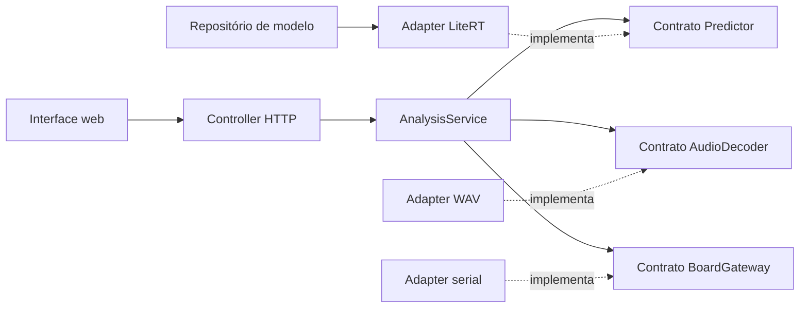

# Arquitetura e padrões aplicados

A organização distingue o objetivo didático do pipeline científico. A interface não acessa diretamente o interpretador ou a serial. Os casos de uso recebem dependências pelos construtores e podem ser testados sem placa.

| Padrão | Implementação | Problema resolvido |
|---|---|---|
| Ports and Adapters | `domain/ports.py`, `adapters/` | Trocar runtime/transporte sem reescrever os casos de uso |
| Injeção de dependências | Construtor de `AnalysisService`, composição em `bootstrap.py` | Testar fluxo e falhas sem abrir USB ou carregar o modelo em cada teste |
| Repository | `FrozenModelRepository`, `EvidenceRepository` | Centralizar leitura e integridade de artefatos, sem caminhos particulares |
| Controller / apresentação | `web/controller.py`, `web/static/js/views.js` | Separar validação de pedidos da renderização e do processamento numérico |
| Objetos de valor | Dataclasses em `domain/models.py` | Explicitar dados de áudio, inferência e captura |

Não foi adicionado Singleton para o modelo: sua vida útil pertence à aplicação composta em `bootstrap.py`. O lock protege um interpretador compartilhado por pedidos HTTP. A serial tem seu próprio lock e a conexão é encerrada pelo context manager.

## Fluxos

**PC:** controller valida o pedido, decoder produz PCM16 canônico, predictor extrai MFE e executa LiteRT, service monta a resposta. Não abre dispositivo.

**Comparação:** os mesmos bytes PCM16 seguem ao adapter serial. Uma falha da placa preserva o resultado do PC com `board_error`; não fabrica uma resposta da placa.

**Microfone:** a placa devolve PCM e CRC. Qualidade baixa/saturação gera resposta sem previsão. Se aceita, o mesmo PCM é analisado no PC. Isso não cria validação clínica ou detecção de sons não cardíacos.

## Recursos e compatibilidade

O modelo, o limiar e a normalização são validados antes de iniciar. O manifesto e os recursos ficam no pacote Python, de modo que a instalação funciona fora da pasta do autor. Os dois áudios mantêm os escores de referência conhecidos em testes de regressão.

A rotina numérica `signal.py` conserva as operações do estudo. O pacote `research/` mantém uma cópia histórica do pipeline e seu próprio front-end para não alterar as fontes/proveniência de experimentos congelados. Essa duplicação delimitada é intencional; novas versões exigem validação de equivalência, não uma troca silenciosa.

As fontes C++ de `apps/demo` e `apps/benchmark` foram mantidas; o CMake e a localização dos headers foram reorganizados. Isso requer novo build. Não se atribuem ao novo binário as medidas de um build antigo sem novo registro.

## Limites HTTP

Loopback, validação de Host e Origin, nonce CSRF sem código na URL, lista fechada de recursos estáticos, limite de tamanho e respostas de erro separadas. A configuração não deve ser ampliada para acesso público sem um desenho de autenticação/deploy próprio.
