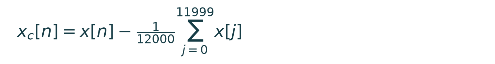
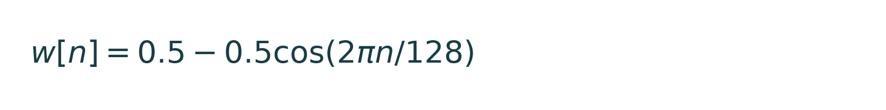
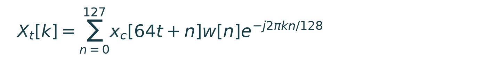
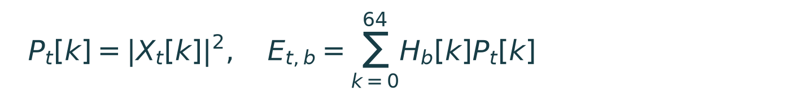
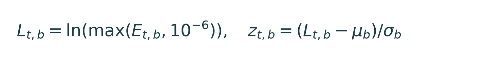
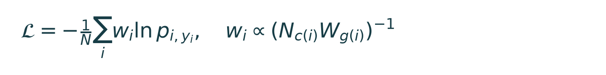
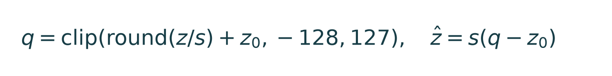
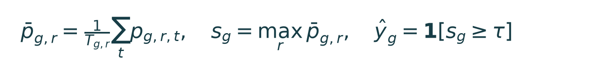

# TinyML na BitDogLab: como fiz, como calculei e o que medi

Projeto de Leandro Alves dos Santos, desenvolvido durante as aulas de Introdução à Inteligência Artificial. Atualização: 27/10/2026.

Os resultados completos são do experimento original. O novo benchmark CPU/RTX/placa tem relatórios próprios; não representa novo training nem nova avaliação do test set.

## Por que levei a rede para a placa?

Minha pergunta foi: **uma rede pequena consegue classificar este conjunto de sons e executar em um RP2040 com poucos recursos?** O objetivo não é vencer o PC em velocidade. É conseguir uma execução local, medir seu custo e compreender seus limites.

No **training**, o computador ajustou os weights com exemplos rotulados, usando a RTX 5050. Na **inference**, os weights ficam fixos e uma nova entrada produz scores. A BitDogLab executa essa segunda parte.

Mesmo modelo, mesmo áudio e mesma classe são um resultado esperado. O que muda entre dispositivos é o tempo, o armazenamento e a implementação. GPU e microcontroller atendem a necessidades diferentes.

A comparação histórica de tempo usou **CPU inference** no PC. Ela não mede RTX inference. O novo benchmark separado mediu RTX inference explicitamente, sem trocar os resultados anteriores.

Como apresentar: “Eu treinei no computador, congelei o modelo e enviei os mesmos samples para a placa. Depois conferi as previsões e medi quanto custou executar.”

## Com sopro e sem sopro

Um **heart murmur** é um som adicional associado ao fluxo de sangue, percebido na ausculta. Pode ser inocente ou estar associado a uma alteração. As duas classes do projeto não equivalem a saudável/doente e não medem beats per minute.

**Esquema didático:** as curvas acima foram criadas apenas para explicar S1, S2 e um som adicional. Não são dados de paciente nem uma segmentação validada da base.

No CirCor, **Murmur Present/Absent** é um rótulo do grupo. Uma pessoa com sopro pode ter um local de ausculta onde ele não é audível. Os trechos de três segundos herdam esse rótulo; ele não prova presença acústica naquele trecho específico.

No painel, “com sopro” significa que o score passou o threshold. “Sem sopro” significa que não passou. Como a rede só conhece duas classes, uma fala ou ruído também pode receber uma delas. Não há detector de áudio desconhecido neste modelo.

Fontes: American Heart Association, Heart Murmurs; Oliveira et al., CirCor DigiScope 1.0.3.

## Sampling e framing

**Sampling rate:** 4.000 samples/s. Em 3 s, N = 3 × 4.000 = 12.000 samples. Cada sample PCM16 ocupa 2 bytes: 24.000 bytes de sinal. Isso é diferente do tamanho do modelo.

Primeiro removo a componente DC de cada janela, subtraindo sua média. Em seguida aplico uma Hann window periódica de 128 samples, equivalente a 32 ms. O frame hop é 64 samples, equivalente a 16 ms.

**Número de frames:** 1 + floor((12.000 − 128)/64) = 1 + 185 = 186. Não há centered padding na STFT. Short recordings recebem zero padding antes desse processamento; sobras incompletas de recordings longas são descartadas.

A FFT produz 65 bins de frequência não negativa, de 0 a 2.000 Hz. A distância entre bins é 4.000/128 = 31,25 Hz. O mapeamento para 24 Mel filters resume essa distribuição espectral.

## O áudio vira MFE

**FFT e power spectrum:** para o frame t, calculo a DFT ponderada pela Hann. Uso o módulo ao quadrado, sem normalização da FFT e sem duplicar os bins positivos.

Cada H representa um Mel filter triangular, entre 30 e 1.800 Hz. A escala é m(f) = 2595 log10(1 + f/700). Uso log-energy para comprimir a faixa e normalization por banda para padronizar as features.

Mean e standard deviation são ajustados **somente em training**. O tensor tem 186 frames × 24 bandas × 1 channel = **4.464 valores**. Na inference, esses coeficientes ficam congelados.

## A CNN e seu training

 | Layer | Output shape | Parameters |
| --- | --- | --- |
| Input | 186 × 24 × 1 | 0 |
| Conv2D 3×3 + ReLU | 186 × 24 × 8 | (9×1 + 1)×8 = 80 |
| MaxPool 2×2 | 93 × 12 × 8 | 0 |
| Conv2D 3×3 + ReLU | 93 × 12 × 16 | (9×8 + 1)×16 = 1.168 |
| MaxPool 2×2 | 46 × 6 × 16 | 0 |
| Global Average Pooling | 16 | 0 |
| Dense + Softmax | 2 | (16 + 1)×2 = 34 |

**Total:** 80 + 1.168 + 34 = 1.282 parâmetros. Conv2D combina padrões locais do mapa; ReLU mantém max(0, a); MaxPool reduz a grade; Softmax converte os dois logits em scores que somam um. Os scores não foram calibrados como probabilidades clínicas.

Weighted cross-entropy reduz a dominância da classe maior e de grupos com muitas janelas. Nc conta grupos de training na classe e Wg conta janelas do grupo; weights são reescalados para média 1. Adam usa learning rate 0,001, batch size 32 e early stopping de 10 épocas sem melhora em validation F1.

## INT8: números menores, com aproximação

**Float32** armazena cada número em 32 bits; **INT8** usa um signed integer de 8 bits, com 256 códigos. Ativações usam −128 a 127. Weights de Conv2D usam quantization por channel; bias e accumulators podem usar INT32.

A scale representa o passo entre códigos e o zero-point representa o zero real. No input deste modelo: **scale = 0,04310979694; zero-point = −38**. O rounding usado é half away from zero, seguido por saturation.

 | Conta | Valor |
| --- | --- |
| Input z = 1,0000 | round(1 / 0,04310979694) − 38 = −15 |
| Reconstrução | (−15 + 38) × 0,04310979694 = 0,991525 |
| Erro nesse exemplo | 0,991525 − 1 ≈ −0,008475 |
| Zero real | q = −38 → z reconstruído = 0 |
| Output real | p = (q + 128) / 256; passo = 0,00390625 |

**Por que usei:** o tensor de input ocupa 4.464 bytes em INT8, contra 17.856 em Float32. O arquivo INT8 completo tem 5.264 bytes, incluindo grafo e metadados. Não é correto multiplicar esse arquivo por quatro para estimar o Float32. O MFE continua em floating point; INT8 não converte automaticamente todo o programa.

A post-training quantization usou 300 janelas de training para calibration. Não treinamos uma rede nova e não usamos o test set para escolher escalas. Fonte: LiteRT 8-bit quantization specification.

## Como escolhi o modelo

 | Partição | Grupos | Present / Absent | Recordings / windows |
| --- | --- | --- | --- |
| Training | 568 | 109 / 459 | 2.066 / 28.340 |
| Validation | 122 | 24 / 98 | 439 / 6.154 |
| Test | 122 | 24 / 98 | 471 / 6.512 |

O split agrupa identidades vinculadas e duplicatas **antes** de segmentar. Todas as visitas, locais e janelas do grupo permanecem juntas. Unknown foi excluído. Isso reduz leakage conhecido, mas vínculos não anotados continuam sendo uma limitação.

Três seeds: 42, 43 e 44. O checkpoint escolhido foi seed 43, época 66, pelo F1 de validation = 0,711. As curvas são dos CSVs realmente salvos; oscilação em validation não é uma curva de test. O test set não foi usado para retuning.

## Como cheguei aos resultados

Faço mean dos window scores em cada recording. Depois tomo o maximum entre recordings do mesmo grupo. O threshold é escolhido em validation. No INT8, τ = 0,734675480769; no Float32, τ = 0,725111204844.

 | Referência do grupo | Previsto com sopro | Previsto sem sopro |
| --- | --- | --- |
| Present | 17 true positives | 7 false negatives |
| Absent | 8 false positives | 90 true negatives |

**Precision:** 17/(17+8) = 0,680. **Recall:** 17/(17+7) = 0,7083. **F1:** 2×17/(2×17+8+7) = 34/49 = 0,6939. **Accuracy:** (17+90)/122 = 0,8770.

Um classificador “sempre ausente” já obteria 98/122 = 80,3% de Accuracy, mas Recall = 0. Por isso Accuracy sozinha não é suficiente. A placa perdeu 7 dos 24 grupos positivos.

O F1 teve IC95% de 0,526 a 0,829, por patient bootstrap com 2.000 repetições. É uma incerteza grande. As decisões da placa e do CPU reference coincidiram nos 122 grupos, mas features/escores não foram sempre idênticos: não há equivalência bit a bit.

## CPU, RTX e placa: resultados novos

O benchmark de 27/10/2026 foi concluído: 100 validation windows, dez warm-up calls e três repetições, batch size um. Os cinco modos usam os mesmos PCM e o mesmo modelo treinado. Não houve novo training nem mudança do threshold.

 | Execução | Inference mediana (ms) | MFE + network (ms) |
| --- | --- | --- |
| CPU Float32 / TensorFlow | 0,661 | 0,836 |
| RTX Float32 / TensorFlow | 0,768 | 0,956 |
| CPU Float32 / reference | 1,347 | 1,509 |
| CPU INT8 / reference | 1,932 | 2,113 |
| RP2040 INT8 / demo V3 | 312,077 | 1.322,608 |

Na sessão medida, a RTX não reduziu a latência individual. CPU/RTX Float32 usam TensorFlow graph call com readback sincronizado; a criação/upload do input não entra em inference. MFE roda na CPU. Os modos reference usam TFLite 2.21 BUILTIN_REF, uma thread e tempo de Invoke. A placa usa timestamps do firmware V3 a 133 MHz.

**Float32 × INT8:** arquivos TFLite de 7.984 e 5.264 bytes, redução de 34,1%. A nova conversão Float32 concordou com o modelo CPU até 4,77 × 10⁻⁷ nas cem entradas. INT8 não foi mais rápido no reference kernel da CPU. A diferença média absoluta de score foi 0,01454; máxima 0,05866. Duas windows mudaram de classe no mesmo threshold INT8. Não é uma nova patient accuracy.

CPU INT8 e placa tiveram scores iguais nas cem windows. Repetir a mesma chamada três vezes não cria novos pacientes. Ordem fixa dos modos, variação de execução e escopos de timer distintos limitam conclusões sobre hardware. Dispatch/readback é uma hipótese para a diferença da GPU, não um mecanismo isolado pelo teste.

O test completo original permanece com F1 0,694 na placa. O benchmark novo é um experimento suplementar de validation. Seus relatórios, linhas individuais e hashes foram auditados antes desta atualização.

## Áudios para a apresentação

 | Áudio | Recording | Rótulo do grupo | Score / previsão |
| --- | --- | --- | --- |
| 1 | 39043_AV | Sopro ausente | 0.56640625 / sem sopro |
| 2 | 49627_AV | Sopro presente | 0.8984375 / com sopro |
| 3 | 49568_AV | Sopro ausente | 0.41015625 / sem sopro |
| 4 | 49719_AV | Sopro ausente | 0.41796875 / sem sopro |
| 5 | 49900_AV | Sopro presente | 0.96875 / com sopro |
| 6 | 50221_AV | Sopro presente | 0.84375 / com sopro |

Os seis trechos vêm de seis grupos de validation e foram escolhidos pela ordem dos identificadores, antes de calcular os scores. São exemplos didáticos, não uma amostra representativa nem evidência de 100% de acerto. O painel analisa WAV e permite comparar o mesmo PCM por USB.

**Roteiro prático:** explicar training e inference; ouvir dois exemplos; mostrar waveform e MFE; calcular a saída no PC; repetir o mesmo PCM na placa; mostrar tempo e score; concluir com os erros do teste completo. A demonstração de microfone fica separada porque acrescenta acústica, ruído e aquisição não validados.

Fontes verificáveis

CirCor DigiScope 1.0.3: https://physionet.org/content/circor-heart-sound/1.0.3/ (DOI 10.13026/tshs-mw03).

Oliveira et al., CirCor original publication: DOI 10.1109/JBHI.2021.3137048.

Reyna et al., PhysioNet Challenge 2022: DOI 10.1371/journal.pdig.0000324.

David et al., TensorFlow Lite Micro, MLSys 2021: proceedings.mlsys.org, volume 3.

Google AI Edge, LiteRT 8-bit quantization specification: developers.google.com/edge/litert/conversion/tensorflow/quantization/quantization_spec.

American Heart Association, Heart Murmurs: heart.org/en/health-topics/heart-murmurs.

Código: https://github.com/Lawtrel/bitdoglab-heart-tinyml. Evidências: relatórios congelados e CSVs do experimento original, com hashes preservados.
